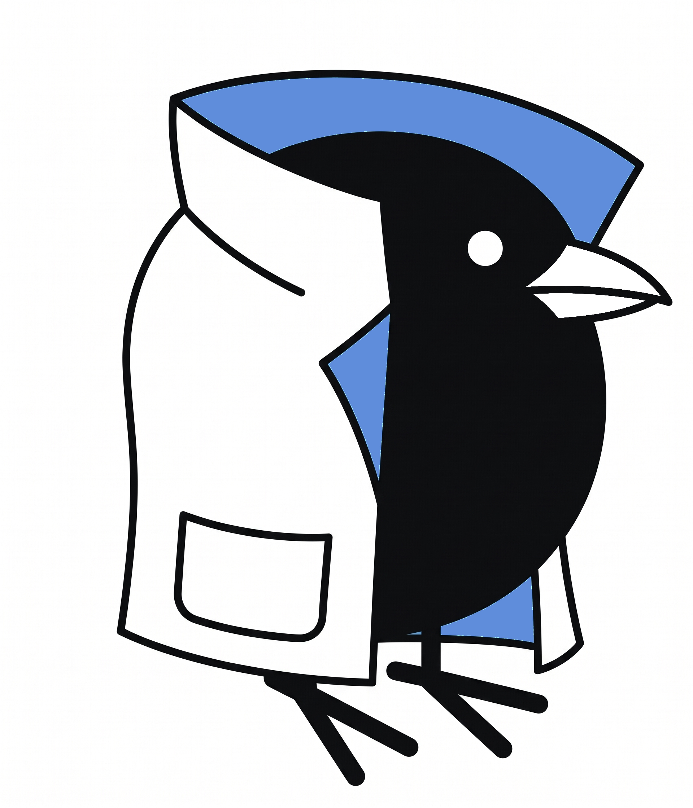

<!-- ================================================================= -->
<!-- 1. HEADER BANNER                                                  -->
<!-- CHANGE LINK / IMAGE: Update 'banner.png' or provide an external image URL -->
<!-- ================================================================= -->

<!-- ================================================================= -->
<!-- 2. SOCIAL & REPO BADGES                                           -->
<!-- CHANGE LINKS: Update your usernames/links and badge colors below  -->
<!-- ================================================================= -->

&nbsp;

&nbsp;

&nbsp;

&nbsp;
<!--  -->

# 👋 &nbsp;Hi there, I'm Juan Pablo (Tyreans)

<!-- CHANGE TEXT & LINKS: Customize your bio, location, interests, and personal website below -->
I'm a Computer Systems Engineering student passionate about making software accessible, intuitive, and easy to use for everyone. My focus is on building comfortable, seamless experiences for everyday users. Always eager to collaborate on projects where I can keep learning, explore new tools, and support the community.

- 📍 Based in: **Torreón, Coahuila, México** 🇲🇽
- 🌐 Website / Portfolio: [tyreans.dev](https://tyreans.dev) <!-- O actualízalo por https://tyreans.github.io -->
- 💬 Connect with me on: [Twitter / X](https://x.com/Tyrean_s) or [LinkedIn](https://www.linkedin.com/in/juan-pablo-chavez-ramirez-205559371/)
- 🎓 **Background:** Computer Systems Engineering Student
- 💡 **Interests:** User-friendly applications, practical utilities, and web development
- 🤝 **Collaboration:** Open to learning-oriented projects and community ideas
- ⚡ **Philosophy:** Software should feel comfortable and straightforward for anyone using it.

&nbsp;

## 👇 &nbsp;Current project

<!-- ================================================================= -->
<!-- 3. CURRENT PROJECT                                                -->
<!-- ================================================================= -->

Currently, I'm working on **[VGBuilder](https://github.com/Metips-Solutions/VGBuilder)**. It's a gacha game team optimizer (starting with Genshin Impact) that recommends builds based on your real inventory, not tier lists. It uses a client-side tag-affinity engine and lets you import characters via Enka.Network.

Built with Bun, Elysia, Drizzle ORM, PostgreSQL, React, and Docker.

<!-- CHANGE LINK / IMAGE: Add a preview screenshot/GIF or comment out this line if not needed -->
<!--  -->

&nbsp;

## ✏️ &nbsp;Blog posts / Articles

<!-- ================================================================= -->
<!-- 4. BLOG POSTS                                                     -->
<!-- CHANGE LINKS: Replace with your actual article links and titles.  -->
<!-- If you use github-readme-blog-post-action workflow, keep START/END tags -->
<!-- ================================================================= -->
<!-- BLOG-POST-LIST:START -->
- [Building Scalable Web Apps with Next.js and TypeScript](https://tyreans.dev/blog/nextjs-typescript-guide)
- [Clean Architecture & Modern Tooling for Full-Stack Projects](https://tyreans.dev/blog/modern-developer-tooling)
- [Lessons Learned from Open Source and Building Side Projects](https://tyreans.dev/blog/lessons-open-source)
<!-- BLOG-POST-LIST:END -->

&nbsp;

## 🧰 &nbsp;My toolbox

<!-- ================================================================= -->
<!-- 5. TECH STACK / TOOLBOX                                           -->
<!-- Add, remove, or reorder icons. Using official Devicon SVG icons.  -->
<!-- Devicon library: https://devicon.dev                              -->
<!-- ================================================================= -->
### 💻 &nbsp;Languages

   &nbsp;
   &nbsp;
   &nbsp;
   &nbsp;
   &nbsp;
   &nbsp;
   &nbsp;
  

### ⚡ &nbsp;Frameworks & Runtimes

   &nbsp;
   &nbsp;
   &nbsp;
   &nbsp;
   &nbsp;
  

### 🗄️ &nbsp;Databases

   &nbsp;
   &nbsp;
  

### 🛠️ &nbsp;Tools & Platforms

   &nbsp;
   &nbsp;
   &nbsp;
   &nbsp;
   &nbsp;
   &nbsp;
   &nbsp;
   &nbsp;
   &nbsp;
   &nbsp;
  

&nbsp;

## 🖥 &nbsp;Past work / Featured repositories

<!-- ================================================================= -->
<!-- 6. FEATURED REPOSITORIES                                          -->
<!-- Cambia 'repo=...' por el nombre exacto de tus repositorios públicos -->
<!-- ================================================================= -->

&nbsp;

&nbsp;

&nbsp;

&nbsp;

## 📊 &nbsp;Stats

<!-- ================================================================= -->
<!-- 7. GITHUB STATS & STREAK                                          -->
<!-- ================================================================= -->

&nbsp;

## 🎵 &nbsp;Daily Soundtrack

<!-- ================================================================= -->
<!-- 8. DAILY SOUNDTRACK                                               -->
<!-- ================================================================= -->
<!-- MUSIC:START -->

  
    
  
   
  🎧 <em>Click en el banner o título para escuchar en Youtube Music</em>

<!-- MUSIC:END -->

&nbsp;

<!-- ================================================================= -->
<!-- 9. FOOTER / SOCIAL LINK                                           -->
<!-- ================================================================= -->

  <a href="https://github.com/Tyreans">Follow me on GitHub</a>

